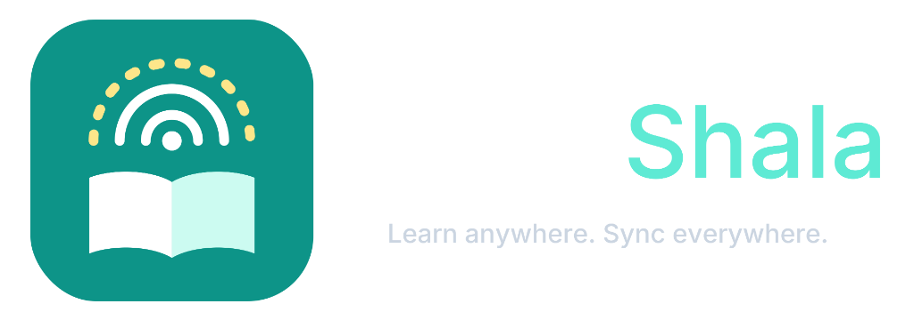

# 📖 SyncShala
> **Learn anywhere. Sync everywhere.**



A resilient, offline-first educational PWA and FastAPI backend designed for low-connectivity environments (rural schools, field research, and developing infrastructure). 

Students can download lessons and quizzes, complete assessments completely offline, survive device reboots or app restarts without losing a single answer, reconnect, and synchronize progress reliably. If network transmission is interrupted after the server processes the submission, retries are guaranteed to be **strictly idempotent**: the teacher receives **EXACTLY ONE** submission with all answers, and the system reports **Zero Duplicates**.

---

## 🏗️ Tech Stack

- **Frontend**: React 18, Vite, TypeScript, `vite-plugin-pwa` (Workbox offline shell precaching & web app manifest), Dexie.js (IndexedDB client database), React Router v6.
- **Backend**: Python 3.11+, FastAPI, SQLite with SQLAlchemy ORM, Pydantic v2.
- **Monorepo Layout**: `/frontend` and `/backend`.
- **UI Design**: Mobile-first, large touch targets (min 48px), clean CSS without bulky UI component libraries.

---

## 🌟 Key Architecture & Capabilities

### 1. Offline Core & Storage (Dexie.js / IndexedDB)
- **App Shell Precaching**: Service Worker precaches static assets, HTML, JavaScript, and styles so the app loads with zero network access after initial visit.
- **Granular Answer Persistence**: Every answer selected by the student is immediately written to IndexedDB. If the browser tab is refreshed or the device restarts, the attempt resumes exactly where the student left off.
- **Decoupled Quizzes & Secure Answers**: Quizzes delivered to clients **never** contain correct answers or explanations; scoring and grading logic remain strictly server-side.

### 2. Idempotent Sync Engine
- **Idempotency Key**: On quiz start, a cryptographically secure client UUID is generated (`submission_id`). Every sync attempt uses this same UUID.
- **State Machine**: Each submission transitions through `PENDING -> SYNCING -> SYNCED` (or `FAILED` with automated exponential backoff up to 5 retries, plus manual Retry).
- **Zero-Duplicate Server Enforcement**: SQLite enforces a `PRIMARY KEY / UNIQUE` constraint on `submission_id`. If an identical `submission_id` is posted again, the backend catches concurrency/replays and returns the existing row with HTTP 200 and the header:
  ```http
  X-Idempotent-Replay: true
  ```
- **Audit Logging**: Per-item transmission log recording each attempt, timestamp, HTTP status, and whether an idempotent replay occurred.

### 3. Demo Fault Injection
- Includes a **Developer / Demo Panel** with a toggle: *"Simulate dropped connection on next upload"*.
- When armed, the client transmits `X-Simulate-Drop: true`. The server **COMMITS** the record to SQLite and then immediately severs/aborts the connection before returning the response.
- When the client's retry loop fires with the same `submission_id`, the server detects the existing record and responds with `X-Idempotent-Replay: true`—demonstrating that zero duplicate rows were created in the database.

### 4. Documented Conflict Rules
1. **Immutability of Submitted Attempts**: Once an attempt transitions to `SUBMITTED`, later offline edits to that `submission_id` are ignored and will never overwrite it.
2. **Latest Timestamp Wins (In-Progress Answers)**: During partial answer synchronization (`PATCH /api/submissions/{id}/answers`), conflicts are resolved per-question based on the latest `client_answered_at` timestamp.
3. **Server Content Supremacy**: Server lesson/quiz versions always supersede client cached versions. The client updates cached content upon reconnection.

### 5. Integrity Extras (Phase 5)
- **HMAC-SHA256 Payload Signature**: Client signs answers with a student session key; backend verifies authenticity.
- **Gzip Request Body Decompression**: Middleware accepts `Content-Encoding: gzip` for low-bandwidth cellular environments.

---

## 📁 Monorepo Folder Tree

```
offline-learning/
├── backend/
│   ├── app/
│   │   ├── __init__.py
│   │   ├── database.py       # SQLite engine, session maker, get_db dependency
│   │   ├── models.py         # SQLAlchemy models (Lesson, Quiz, Submission, User)
│   │   ├── schemas.py        # Pydantic v2 validation models
│   │   ├── seed.py           # Seed data (2 lessons, 2 quizzes, 2 students, 1 teacher)
│   │   └── main.py           # FastAPI routes, CORS, idempotency handler, fault injection
│   ├── tests/
│   │   ├── __init__.py
│   │   ├── conftest.py       # Pytest fixtures and in-memory test database
│   │   ├── test_submissions.py # Pytest tests for idempotency, drop, conflict rules, Phase 5
│   │   └── test_acceptance.py  # End-to-end 6-step acceptance test
│   └── requirements.txt      # FastAPI, Uvicorn, SQLAlchemy, Pytest, HTTPX
├── frontend/
│   ├── public/
│   │   ├── favicon.ico
│   │   ├── icon-192.png      # PWA install icon (192x192)
│   │   ├── icon-512.png      # PWA install icon (512x512)
│   │   └── vite.svg
│   ├── src/
│   │   ├── components/
│   │   │   ├── Navbar.tsx         # Navigation bar & student/teacher role switcher
│   │   │   └── NetworkBanner.tsx  # Online/Offline banner with manual sync trigger
│   │   ├── db/
│   │   │   └── db.ts              # Dexie IndexedDB schema
│   │   ├── pages/
│   │   │   ├── DownloadsPage.tsx  # Download lessons & quizzes for offline use
│   │   │   ├── QuizPage.tsx       # Offline quiz runner with instant answer persistence
│   │   │   ├── AttemptsPage.tsx   # View in-progress and submitted student attempts
│   │   │   ├── SyncPage.tsx       # State machine inspection & per-item audit logs
│   │   │   ├── TeacherPage.tsx    # Instructor dashboard with "Duplicates detected: 0"
│   │   │   ├── DemoPage.tsx       # Fault injection controls & judge acceptance runbook
│   │   │   └── HelpPage.tsx       # Conflict resolution documentation
│   │   ├── services/
│   │   │   ├── api.ts             # REST client
│   │   │   ├── crypto.ts          # Web Crypto HMAC-SHA256 signing
│   │   │   └── syncEngine.ts      # Offline sync engine with exponential backoff
│   │   ├── styles/
│   │   │   └── index.css          # Mobile-first CSS with large touch targets
│   │   ├── types/
│   │   │   └── index.ts           # Shared TypeScript interfaces
│   │   ├── App.tsx                # React Router & shell setup
│   │   ├── main.tsx               # Entry point & PWA service worker registration
│   │   └── vite-env.d.ts
│   ├── index.html
│   ├── package.json
│   ├── tsconfig.json
│   ├── tsconfig.node.json
│   └── vite.config.ts        # Vite + vite-plugin-pwa configuration with proxy
└── README.md
```

---

## 🚀 Quickstart: All-In-One Localhost

Everything (the PWA frontend, the service worker, and the backend REST API) is configured to run on a **single unified localhost URL**:

### One-Click Start (Single Command)

From the project root:

```bash
# Option A: Using npm
npm start

# Option B: Using PowerShell directly
.\start.ps1

# Option C: Double-click start.bat in Windows Explorer
.\start.bat
```

Once running, simply open **`http://127.0.0.1:8000`** in your browser!

| Resource | Single Localhost URL |
| :--- | :--- |
| **Student Offline PWA** | [http://127.0.0.1:8000](http://127.0.0.1:8000) |
| **Teacher Dashboard** | [http://127.0.0.1:8000/teacher](http://127.0.0.1:8000/teacher) |
| **Sync Queue & Audit Logs** | [http://127.0.0.1:8000/sync](http://127.0.0.1:8000/sync) |
| **Fault Injection Simulator** | [http://127.0.0.1:8000/demo](http://127.0.0.1:8000/demo) |
| **Interactive API Docs** | [http://127.0.0.1:8000/docs](http://127.0.0.1:8000/docs) |

---

## 🛠️ Alternative: Separate Dev Servers Mode (Optional)

If you are developing frontend components with Vite Hot-Module Replacement (HMR):

```bash
# Navigate to backend directory
cd backend

# Create virtual environment and activate
# Windows (PowerShell):
python -m venv .venv
.\.venv\Scripts\Activate.ps1

# Linux / macOS:
# python3 -m venv .venv
# source .venv/bin/activate

# Install dependencies
pip install -r requirements.txt

# Start FastAPI server on port 8000
python -m uvicorn app.main:app --host 127.0.0.1 --port 8000 --reload
```

The backend starts at `http://127.0.0.1:8000`. Swagger API docs are available at `http://127.0.0.1:8000/docs`.

### 2. Frontend Setup & Startup

In a second terminal:

```bash
# Navigate to frontend directory
cd frontend

# Install npm dependencies
npm install

# Start Vite dev server on port 3000
npm run dev
```

Open your browser to **`http://localhost:3000`**.

---

## 🧪 Running the Backend Test Suite

The test suite validates:
1. Double-posting identical `submission_id` creates exactly 1 database row.
2. Simulated dropped connection followed by retry produces 1 row with all answers.
3. Conflict rule behavior (submitted attempt immutability & timestamp resolution).
4. Quiz endpoints never leak correct answers to clients.
5. Teacher dashboard detects 0 duplicates.
6. Full 6-step end-to-end acceptance test workflow.
7. Gzip request decompression and HMAC-SHA256 signature verification.

```bash
cd backend
# Windows:
$env:PYTHONPATH = "backend"
.\.venv\Scripts\pytest -v tests

# Linux / macOS:
# PYTHONPATH=backend pytest -v tests
```

---

## 🏆 Acceptance Test: Judge Walkthrough

Follow these steps to experience the complete offline flow and fault injection:

1. **Download Lessons & Quizzes Online**:
   - Open `http://localhost:3000` in Chrome/Edge.
   - Click **"Download All for Offline"**. The green *"✓ Downloaded"* and *"✓ Ready Offline"* badges appear.
2. **Go Offline**:
   - Open Developer Tools (`F12`) → **Network** tab → change throttling dropdown from *No throttling* to **"Offline"** (or turn off Wi-Fi).
   - Notice the global top banner updates to: **`OFFLINE MODE: Zero connectivity`**.
3. **Take Quiz 1 Completely Offline**:
   - Click **"Take Quiz"** on *Python Fundamentals Quiz*.
   - Answer all 5 questions.
   - Each answer is saved to IndexedDB the moment it is clicked.
4. **Survive App Restart / Refresh**:
   - Hard refresh the page (`Ctrl+F5` / `Cmd+Shift+R`) while **still offline**.
   - Notice the Service Worker immediately serves the app shell, and the quiz resumes with your selected answers intact!
5. **Arm Fault Injection**:
   - Navigate to **"⚡ Demo Panel"**.
   - Check the box: **"Simulate Dropped Connection on Next Upload"** (this sets `X-Simulate-Drop: true` for the next upload only).
6. **Reconnect & Submit**:
   - In DevTools Network tab, switch back to **"Online"** (or reconnect Wi-Fi).
   - Click **"Submit Quiz"** (or click *"Sync Now"* on the banner).
   - The first upload reaches the server, commits to SQLite, and drops the connection before returning HTTP 200.
   - In **"Sync Queue & Logs"**, inspect the log: notice the attempt recorded as **DROPPED / FAILED**.
7. **Retry & Verify Idempotent Success**:
   - The sync engine automatically retries (or click **"⚡ Retry Now"**).
   - The server recognizes the existing `submission_id`, returns `200 OK` with header `X-Idempotent-Replay: true`.
   - The status updates to **SYNCED**.
8. **Verify Teacher Dashboard**:
   - Navigate to **"👩‍🏫 Teacher View"** (`/teacher`).
   - Notice:
     - Exactly **ONE** submission exists for this attempt with all 5 answers and a computed score (e.g., 100%).
     - The metric **"✓ Duplicates Detected"** shows **`0`**.
     - The metric **"Retries Absorbed"** shows **`1`** (the idempotent replay).

---

## ⚠️ Known Limitations & Future Enhancements

1. **Browser Quota Eviction**: Modern browsers may evict IndexedDB under extreme disk storage pressure; in a production native Android/iOS wrapper (e.g. Capacitor/React Native), SQLite should be used for persistent client storage.
2. **Clock Skew on Client Timestamps**: In-progress answer conflict resolution relies on ISO timestamps generated on student devices. If device clocks are drastically desynchronized, a Lamport timestamp or hybrid logical clock (HLC) can be incorporated.
3. **Teacher Authentication**: In this prototype, role switching between students and teacher is implemented via local UI state for ease of demonstration without requiring an OAuth/JWT provider.
